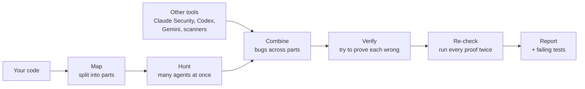
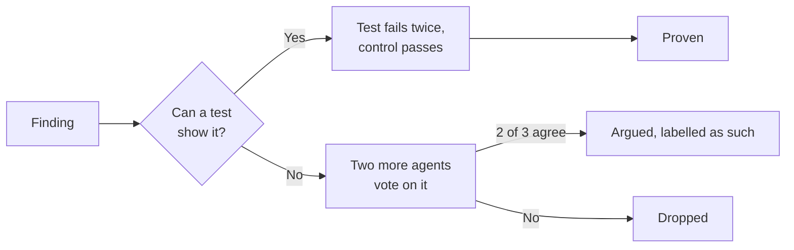

# Ares

Ares finds bugs in your code and proves them.

Point it at a folder. It reads every file, finds what is wrong, and writes a failing test for each bug it reports. If it can't prove a bug, it tells you so.

```
/ares src/api
```

## What it finds

Anything that is wrong for someone, not only security holes.

| Kind of bug | Example |
| --- | --- |
| Access | A user opens another user's order by changing the id in the URL |
| Money and numbers | Splitting $10.00 into 3 payments charges $9.99 |
| Timing | Two refunds sent at the same moment both pay out |
| Broken promises | The page says "admins only", but the server lets anyone in |
| Failures | A card is charged, the save fails, and the customer sees "You were not charged" |
| Database | A rule the code relies on isn't enforced by the database |
| Weak tests | A test passes, but would still pass with the rule deleted |
| Untrusted input | A file name like `../../secrets` reads files outside the folder |

It reviews code as it stands. Old code gets the same scrutiny as new code.

## How it works



1. **Map.** One agent reads the code and splits it into parts: who calls what, what each part must guarantee, and where the trust boundaries are.
2. **Hunt.** Many agents work at once. One takes each part and tries to break its guarantees. Seven more each look for one kind of bug across all the code.
3. **Combine.** One agent looks for bugs that only appear when two parts work together.
4. **Verify.** Every finding goes to a new agent whose job is to prove it wrong. Where it can, it writes a test that fails because of the bug, plus a test that passes, to show the setup is sound.
5. **Re-check.** Ares runs every proof twice. A proof that doesn't fail the same way both times is thrown out.

Agents never see each other's reasoning, and they never see earlier reviews. Each one starts fresh.

### Proven or not



## What makes it different

Most AI code review is one model reading the code once. Ares is built on what published research says actually finds bugs, and on one rule: a finding isn't trusted until something has tried to break it.

| | Ares | Claude Security | One-pass AI review | Static analysis (Semgrep, CodeQL) |
| --- | --- | --- | --- | --- |
| Reviews whole code, not only a diff | ✓ | ✓ | Depends | ✓ |
| Finds logic bugs, not only security holes | ✓ | — | Partly | — |
| A separate agent tries to disprove each finding | ✓ | ✓ | — | — |
| Proves findings by running a test | ✓ | — | — | — |
| Re-runs every proof in plain code before trusting it | ✓ | — | — | — |
| Runs database findings against a real database | ✓ | — | — | — |
| Hunts with more than one company's models | ✓ | — | — | — |
| Uses static analysers, coverage and mutation testing as leads | ✓ | — | — | Is the analyser |
| Audits that agents never saw earlier reviews | ✓ | — | — | — |

We haven't found another tool that does all of these together. Ares runs Claude Security inside every review, so you get its findings too.

**Why these choices matter:**

- **Splitting the code first finds 6× more.** In one study, the same model found 3 of 30 access-control bugs when it explored freely, and 18 of 30 when sent through the code one route at a time. Ares maps the code into parts, gives each hunter its entry points and what they must guarantee, and checks the map against git so no file is skipped.
- **Agreement isn't proof.** Ten AI reviewers once agreed on a bug that didn't exist; one test run disproved it. Ares counts a bug as proven only when a test fails for the stated reason, a control test passes, and both still hold when plain code runs them a second time.
- **Most misses are the right place with the wrong cause.** In a benchmark of 265 real bugs, 68% of misses were in the right file. When a verifier rejects a finding, it can name the real bug beside it, and Ares verifies that too.
- **One model shares one set of blind spots.** Codex and Gemini hunt alongside Claude when they're installed, and every finding from every source goes through the same verification.
- **Finding and checking are separate jobs.** Hunters report anything plausible. Verifiers assume each finding is wrong. An agent asked to do both quietly drops real bugs.

The full reasoning and sources are in [DESIGN.md](DESIGN.md). How many bugs Ares catches is not measured yet; `/ares selftest` is how it will be.

## What it uses

Ares runs every tool that is installed and tells you which ones it skipped.

| Tool | What it adds |
| --- | --- |
| Ares agents | The hunt and the proofs |
| Claude Security | A second, independent security review by Anthropic |
| Codex, Gemini | Reviewers from other companies' models, so one model's blind spots don't decide the result |
| Semgrep | Known patterns of unsafe code |
| Gitleaks | Passwords and keys committed to the repository |
| OSV-Scanner | Dependencies with known security problems |
| Postgres | A real database, so database bugs are run, not guessed |
| A local copy of your app | Bugs are proven against a running server |
| Coverage | Code no test ever runs, which gets a closer look |
| Stryker | Rules your tests don't check |
| Your git history | Past fixes, checked for being complete |

Findings from every tool are verified by Ares agents before they reach the report.

## What you get

- **A report** that lists each bug with where it is, how to trigger it, what goes wrong, and the smallest fix
- **A failing test** for every bug that could be proven
- **JSON and SARIF** for other tools and code-scanning dashboards
- **A list of what wasn't covered**, so a clean report never hides a gap

### A finding in the report

This is the format, shown with one of the planted bugs from `/ares selftest`:

> **Instalments lose money when the total doesn't divide evenly** · high · `src/money.js:5`
>
> **Trigger:** A customer pays $10.00 in 3 instalments.
> **What goes wrong:** Each instalment is rounded down to $3.33, so the shop collects $9.99.
> **Needs:** Nothing. Any order that doesn't divide evenly.
> **Proof:** `test/_dr_f1.test.js` fails twice; its control passes.
> **Fix:** Add the remainder to the last instalment.

## Install

You need Claude Code, Node.js and git.

```
git clone https://github.com/chromejaw/ares.git
cd ares
node install.mjs
```

This makes `/ares` available in every project on your machine.

The other tools are optional. Install the ones you want:

```
brew install gitleaks osv-scanner postgresql@17
uv tool install semgrep
claude plugin install claude-security@claude-plugins-official
```

To add Codex or Gemini, install their command-line tools and sign in. Ares then sends the code it reviews to those companies.

## Use

| Command | What it does |
| --- | --- |
| `/ares src/api` | Review a folder |
| `/ares src/api lib/auth.js` | Review several folders or files |
| `/ares` | Review the project's default folders |
| `/ares src/api thorough` | More hunting rounds, three votes per finding, a second model |
| `/ares src/api quick` | Ares agents only, no outside tools |
| `/ares src/api again` | Hunt again, skipping what the last run found |
| `/ares fix <report>` | Fix the bugs in a report, each with a test |
| `/ares selftest` | Run Ares on a small project with eight planted bugs, and score it |

Ares reviews your last commit. If you have uncommitted changes in those folders, it tells you they weren't reviewed.

## Set it up for a project

Ares works without setup. To give it more to go on, add a `.ares/` folder to your project:

- `project.json`: which folders to review by default, files to skip, how to run your tests, how to load your database
- `project.md`: how to write a test in this project
- `lessons.md`: kinds of bugs found here before
- `THREAT_MODEL.md` in the project root: who is trusted, and what matters most

A threat model cuts false reports more than anything else.

## Limits

- **It can miss bugs.** A clean report means Ares found nothing, not that nothing is there. Run it again to find more.
- **It can't test hosted services.** Findings that depend on a third-party service are argued from the code, and the report says so.
- **Big code goes in parts.** Over 8,000 lines, Ares splits the work and reviews one part at a time.
- **It uses a lot of tokens.** A full review runs dozens of agents. Use `quick` for a lighter pass.
- **It doesn't change your code.** It reports and proves. `/ares fix` makes changes only when you ask.

## Status

Every tool around the agents has run on real code. Ares hasn't finished a full review yet, so how many bugs it catches is not yet measured. `/ares selftest` is how it will be.

## Licence

MIT. Files in `vendor/` keep their own licences; see `vendor/PROVENANCE.md`.
